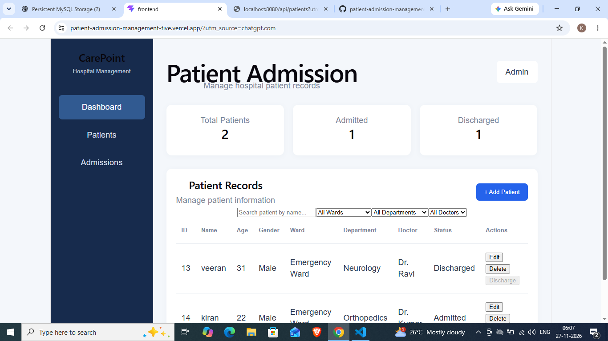

# Patient Admission Management System

A web application to manage hospital patient admissions and records.

## Technology Stack

**Frontend**
- React.js
- HTML
- CSS
- JavaScript

**Backend**
- Java
- Spring Boot
- REST API

**Database**
- MySQL

## Features
- Add new patients
- View all patients
- Search patients by name
- Filter by ward, department and doctor
- Edit patient details
- Delete patients
- Discharge patients
- Frontend and backend validation
- Persistent MySQL storage

## Live Application

Frontend: https://patient-admission-management-five.vercel.app/

**Note:** The online backend connection is still pending.

## Run Locally

### Backend
1. Install Java 21, Maven and MySQL.
2. Create a MySQL database named `patient_management`.
3. Configure database credentials in `application.properties`.
4. Open the backend project folder.
5. Run:

```bash
mvn spring-boot:run
```

Backend URL: `http://localhost:8080`

### Frontend
1. Install Node.js.
2. Open the frontend folder.
3. Run:

```bash
npm install
npm run dev
```

Frontend URL: `http://localhost:5173`

## Screenshots


Add screenshots of:
- Dashboard
- Add Patient form
- Patient list
- Search and filters

## Developer

Karthik A S
